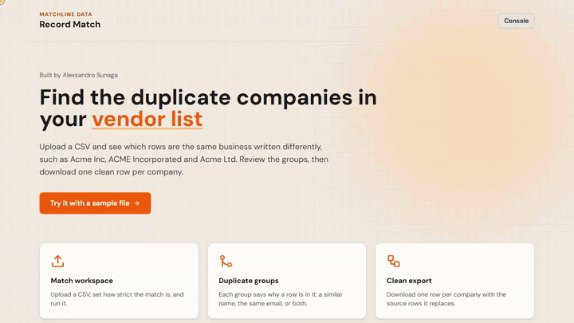
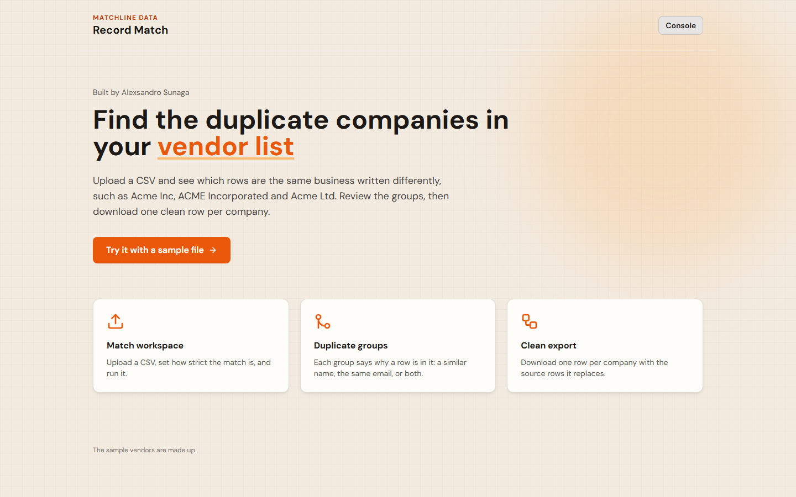
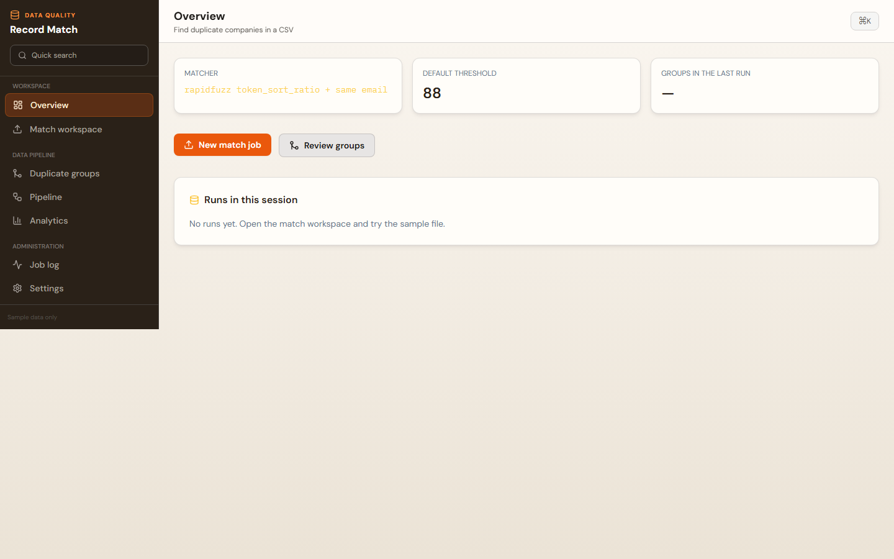
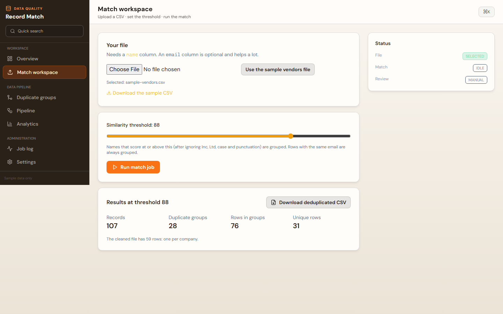
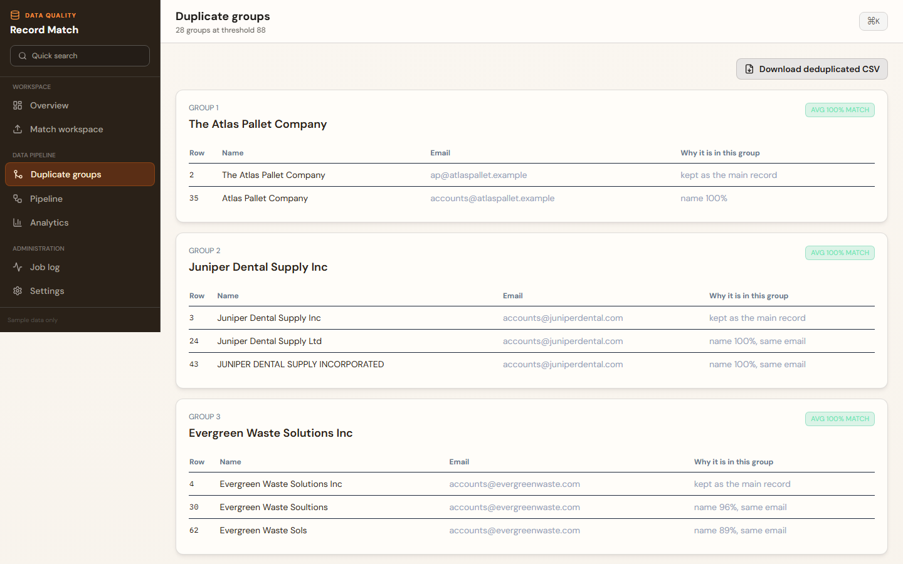

# Matchline

## Video

[](docs/demo/demo.mp4)

About 45 seconds, recorded from the running app: it loads the sample vendor list (107 made-up rows), runs the match at threshold 88 and at 76, reviews the duplicate groups and downloads the cleaned CSV. [Watch the MP4](docs/demo/demo.mp4).

## Screenshots







**Find duplicate companies in a CSV · fuzzy name matching · email matching · cleaned export**


**GitHub topics:** `python`, `fastapi`, `entity-resolution`, `deduplication`, `data-pipeline`, `nextjs`

| Layer | Path | Port |
|-------|------|------|
| **API** | `app/main.py` (FastAPI + RapidFuzz) | 8002 |
| **Console** | `web/` (Next.js dashboard) | 3002 |

## Tech stack

| Area | Technologies |
|------|--------------|
| Frontend | `Next.js`, `React`, `TypeScript`, `Tailwind CSS`, `Radix UI`, `Framer Motion`, `Recharts`, `cmdk` |
| Backend | `Python`, `FastAPI`, `RapidFuzz`, `Pydantic Settings`, `pytest` |

## Run

```bash
# API
cd matchline
pip install -r requirements.txt
uvicorn app.main:app --reload --port 8002

# UI
cd web
npm install
npm run dev
```

Set `NEXT_PUBLIC_API_URL` if API is not on `http://127.0.0.1:8002`.

## How the matching works

1. Names are cleaned: lower case, no punctuation, and legal words such as Inc, Incorporated, LLC, Ltd, Co and The are dropped, so `BRIGHTWELL Supplies, Incorporated` and `Brightwell Supplies Inc` become the same text.
2. Every pair of names is scored with RapidFuzz `token_sort_ratio`. A pair at or above the threshold is linked.
3. Rows with the same email are always linked.
4. Two rows on different email domains stay apart unless their names are almost identical (97+). `Cedar Ridge Packing` and `Cedar Ridge Packaging` with different domains are usually two businesses.
5. Links are followed all the way: if A matches B and B matches C, all three are one group. The group keeps the spelling its email address confirms, then the fullest name.

Every row in a group says why it is there (`name 95%`, `same email`, or both). The cleaned export has one row per company and lists the source rows it replaces.

Limits: every pair is compared, so it is meant for files up to about 2,000 rows. It does not merge fields other than name and email, and a group can be wrong in both directions, so review it before you use the export.

## Console

Overview · Match workspace (sample file, threshold, run, download) · Duplicate groups · Pipeline · Analytics · Job log (this session) · Settings

`GET /health` · `POST /api/match?threshold=88` · `POST /api/dedupe?threshold=88` (CSV download) · `GET /sample`

## Summary

FastAPI + RapidFuzz matching service and a Next.js console for finding duplicate companies in CSV uploads and exporting a cleaned file.

## Tests

```bash
pip install -r requirements.txt -r requirements-dev.txt
python -m pytest -q
```

## Author

**Alexsandro Sunaga**

## License

MIT License — Copyright (c) 2026 Alexsandro Sunaga. See [LICENSE](LICENSE).
